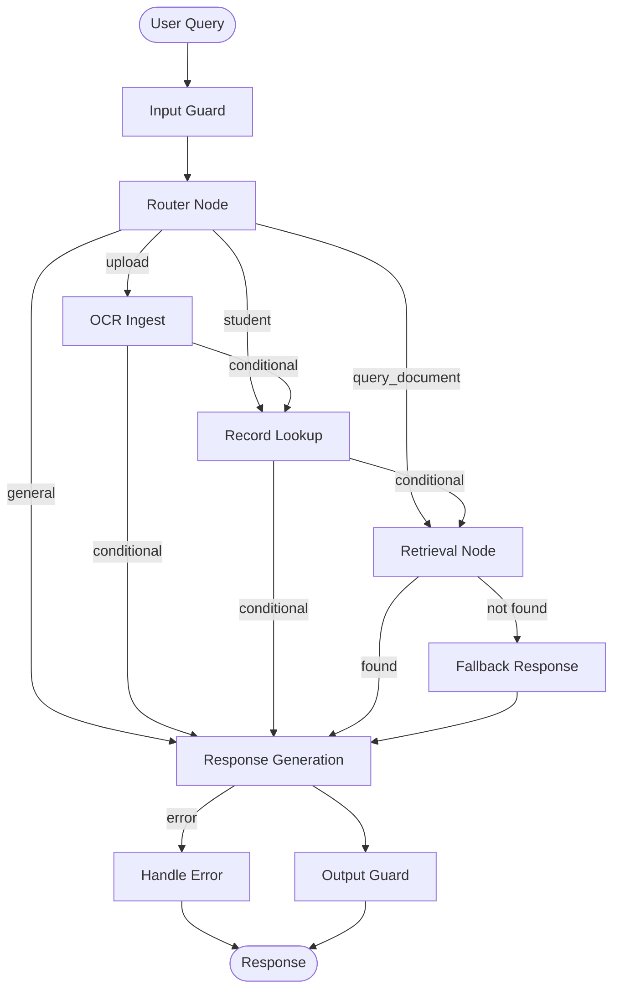
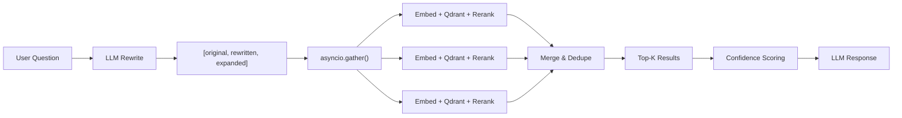

# PASsistant — Academic Services & Student Records Chatbot

A **LangGraph-powered RAG chatbot** for Universitas Pasundan's Faculty of Engineering that answers student questions about **academic policies**, **curriculum**, and **student records**. Features document OCR ingestion, vector indexing, hybrid retrieval (dense + BM25) with cross-encoder reranking, and GLM-OCR for PDF ingestion.

---

## Table of Contents

- [Features](#features)
- [Architecture](#architecture)
- [Quick Start](#quick-start)
- [Launch Options](#launch-options)
- [API Endpoints](#api-endpoints)
- [Document Management](#document-management)
- [Evaluation](#evaluation)
- [Environment Variables](#environment-variables)
- [Development](#development)
- [Project Structure](#project-structure)
- [Documentation](#documentation)
- [Tech Stack](#tech-stack)
- [License](#license)

---

## Features

- **Document Indexing** — Uploaded documents are OCR-processed and indexed for retrieval with document type classification (10 types)
- **Contextual Embeddings** — Indexed text can include document-level context for better semantic matching
- **Hybrid Retrieval** — Dense vector search + BM25 sparse vectors fused with RRF, or cross-encoder reranking
- **Confidence Scoring** — Custom 5-component confidence model to rank and validate answers
- **GLM-OCR** — PDF documents are parsed page-by-page with layout-aware OCR preserving table structure
- **Multi-query Expansion** — Queries are rewritten and expanded (including semester numeral normalization) for higher recall
- **Guardrails** — Input injection detection + output PII masking + system prompt leak prevention
- **RAGAS Evaluation** — Automated RAG quality assessment with Faithfulness, Context Recall, and Factual Correctness
- **Session Management** — In-memory session tracking for continuous conversations
- **Rate Limiting** — In-memory rolling window rate limiting per IP
- **Multi-channel** — Interactive CLI, REST API, WebSocket streaming (with SSE resume via `Last-Event-ID`), and Telegram bot integration (including photo/image uploads)

---

## Architecture



**Retrieval Pipeline Detail:**



---

## Quick Start

### Prerequisites

- Python 3.11+
- [UV](https://docs.astral.sh/uv/getting-started/installation/) package manager
- Docker (for Qdrant & Redis)
- API keys: OpenAI-compatible provider (e.g. OpenRouter), Zhipu AI (GLM-OCR), Jina AI (for reranking fallback, optional) - see [docs/api-keys.md](docs/api-keys.md) for how to obtain them.

### Setup

```bash
git clone <repo-url>
cd PASsistant

# Install all dependencies (including dev and evaluation tools)
uv sync --all-extras

# Configure environment
cp .env.example .env
# Edit .env with your API keys
```

### Run Infrastructure

Ensure your local vector database and caching layers are up and running:

```bash
# Start Qdrant vector database (via Docker or local script)
docker run -p 6333:6333 -p 6334:6334 \
  -v $(pwd)/qdrant_storage:/qdrant/storage \
  qdrant/qdrant

# Alternatively, run via the provided script:
bash scripts/run_qdrant.sh

# Start Redis (required for caching search results)
docker run -p 6379:6379 redis:7-alpine
```

---

## Launch Options

PASsistant supports multiple interface options to interact with and manage the chatbot workflow:

### 1. Interactive CLI Client
Great for quick, lightweight testing directly in your terminal.
```bash
uv run chatbot
```

### 2. REST API Server
Runs the FastAPI backend that handles LangGraph execution, WebSockets, SSE streams, and document ingestion.
```bash
uv run uvicorn src.api:app --reload --port 8000
```
Interactive Swagger API documentation is available at `http://localhost:8000/docs`.

### 3. Telegram Bot (Polling Mode for Dev)
Runs the Telegram bot integration locally using long polling:
```bash
uv run python -m src.telegram_bot.polling
```

---

## API Endpoints

| Method | Endpoint | Description |
|--------|----------|-------------|
| `GET` | `/health` | API and dependency health |
| `POST` | `/chat` | Chat request, optionally with turn-only file context |
| `POST` | `/chat/stream` | Streaming chat (SSE), optionally with files |
| `POST` | `/upload` | Upload and ingest documents into the shared index |
| `GET` | `/documents` | List ingested documents |
| `DELETE` | `/documents/by-filename/{filename}` | Delete indexed documents by filename |
| `POST` | `/documents/{document_id}/reindex` | Reindex one document from OCR cache (admin key) |
| `POST` | `/documents/reindex/by-filename/{filename}` | Reindex cached documents by filename (admin key) |
| `POST` | `/documents/reindex-jobs` | Queue a bulk reindex job (admin key) |
| `GET` | `/documents/reindex-jobs/{job_id}` | Get bulk reindex job status (admin key) |
| `DELETE` | `/documents/reindex-jobs/{job_id}` | Cancel a bulk reindex job (admin key) |
| `POST` | `/telegram/webhook` | Telegram webhook receiver (when enabled) |
| `WS` | `/ws/{thread_id}` | WebSocket chat streaming |

See the [API reference](docs/api.md) for request formats, response schemas,
authentication, error handling, and examples.

---

## Document Management

```bash
# Ingest raw academic handbook or syllabus PDFs
curl -X POST http://localhost:8000/upload \
  -F "files=@Kurikulum_IF_2021.pdf" \
  -F "files=@Buku_Panduan_Akademik.pdf"

# List all ingested documents
curl http://localhost:8000/documents

# Delete a specific document (re-ingest after pipeline changes)
curl -X DELETE "http://localhost:8000/documents/by-filename/Kurikulum%20IF%202021.pdf"
```

### OCR cache and reindexing

Each ingested document stores its raw per-page OCR output under
`data/processed/ocr_cache/{document_id}/` (`pages.json` plus a `meta.json`
written last). The cache makes it possible to change chunking, table handling,
or indexing and re-index without re-running OCR. `keep_files=true` deletes
only the vectors and search cache, keeping the OCR cache and raw file.

```bash
# Reindex one document from its OCR cache
curl -X POST "http://localhost:8000/documents/<document_id>/reindex?rebuild_text=false" \
  -H "X-Admin-Key: $ADMIN_API_KEY"

# Reindex every cached document with a filename
curl -X POST "http://localhost:8000/documents/reindex/by-filename/Kurikulum%20IF%202021.pdf" \
  -H "X-Admin-Key: $ADMIN_API_KEY"

# Queue a bulk job (document_ids: null reindexes every cached document)
curl -X POST http://localhost:8000/documents/reindex-jobs \
  -H "X-Admin-Key: $ADMIN_API_KEY" -H "Content-Type: application/json" \
  -d '{"rebuild_text": false, "document_ids": null}'

# Poll job progress / request cancellation
curl http://localhost:8000/documents/reindex-jobs/<job_id> -H "X-Admin-Key: $ADMIN_API_KEY"
curl -X DELETE http://localhost:8000/documents/reindex-jobs/<job_id> -H "X-Admin-Key: $ADMIN_API_KEY"

# Or use the CLI, which shares the same service layer
uv run python scripts/reindex_from_ocr_cache.py --all
uv run python scripts/reindex_from_ocr_cache.py --filename "Kurikulum IF 2021.pdf" --rebuild-text
```

Reindex endpoints require `X-Admin-Key` to match `ADMIN_API_KEY`; when
`ADMIN_API_KEY` is unset they all return 403. Related settings:
`OCR_CACHE_ENABLED`, `OCR_CACHE_DIR`, `REINDEX_JOB_TTL_SECONDS`.

---

## Evaluation

The evaluation testset is ground truth only (`id`, `user_input`, `reference`,
`reference_contexts`, `metadata`); the pipeline produces the answers and retrieved contexts,
or you supply them with `--fixture`. Every subcommand is available through
`uv run ragas-eval` (equivalently `uv run python -m src.eval`):

```bash
# Validate a testset and print its statistics
uv run ragas-eval validate --dataset testset.jsonl

# Generate a testset from indexed documents; also writes testset.responses.json
uv run ragas-eval build-dataset --output testset.jsonl --testset-size 20

# Score using captured responses (fixture mode)
uv run ragas-eval evaluate --dataset testset.jsonl --mode fixture --fixture testset.responses.json

# Score the live pipeline against the current index
uv run ragas-eval evaluate --dataset testset.jsonl --mode live

# Compare retrieval strategies (one live evaluation per strategy, then a comparison)
uv run ragas-eval sweep --dataset testset.jsonl
```

Every run scores Faithfulness, Context Recall, and Factual Correctness. Each `evaluate` run
writes a report `.json`, a per-sample `.csv`, and a Markdown summary into `src/eval/reports/`;
`compare` and `sweep` write a strategy comparison.

See [docs/evaluation.md](docs/evaluation.md) for the full evaluation guide.

---

## Environment Variables

See [`.env.example`](.env.example) for all available variables. Key ones:

| Variable | Description |
|----------|-------------|
| `OPENAI_API_KEY` | LLM provider API key (OpenRouter, OpenAI, etc.) |
| `OPENAI_BASE_URL` | LLM provider base URL |
| `LLM_MODEL` | Primary LLM model for responses |
| `LLM_PROVIDER` | Restrict the primary LLM to OpenRouter provider endpoints, e.g. `baidu/fp8` (empty = default routing) |
| `QUERY_REWRITE_PROVIDER` | Restrict the rewrite model to its own endpoints (empty = default routing) |
| `LLM_REASONING_ENABLED` | Enable/disable provider reasoning controls |
| `EMBEDDING_MODEL` | Embedding model for vector search |
| `VECTOR_SIZE` | Dimensions of the embedding model |
| `ZHIPU_API_KEY` | Zhipu AI key for GLM-4 OCR |
| `QDRANT_URL` | Qdrant vector database URL |
| `RETRIEVAL_STRATEGY` | `similarity`, `rrf`, or `reranker` |
| `RETRIEVAL_TOP_K` | Number of chunks retrieved per query |
| `RERANKER_PROVIDER` | Primary reranker provider (default: openrouter) |
| `RERANKER_MODEL` | Cross-encoder model (e.g. cohere/rerank-v3.5) |
| `RERANKER_FALLBACK_PROVIDER` | Fallback reranker provider (default: jina) |
| `JINA_API_KEY` | Jina AI key for fallback reranking |
| `TELEGRAM_BOT_TOKEN` | Telegram bot token |
| `TELEGRAM_WEBHOOK_URL` | Target URL for Telegram webhook |
| `TELEGRAM_WEBHOOK_SECRET_TOKEN` | Secret token to authenticate webhook requests |
| `CORS_ALLOWED_ORIGINS` | Allowed origins for API requests |
| `RATE_LIMIT_PER_MINUTE` | Request limit per IP per minute |

---

## Development

```bash
# Run all tests
uv run pytest

# Run specific test suite
uv run pytest tests/test_prod_readiness.py -v

# Format & lint
uv run ruff format .
uv run ruff check .

# Type check
uv run basedpyright src/
```

### Helper Scripts

```bash
bash scripts/setup.sh                  # Full project setup
bash scripts/run_qdrant.sh             # Launch Qdrant via Docker
uv run ragas-eval validate --dataset testset.jsonl # Validate an evaluation testset
python scripts/run_retrieval_smoke_test.py # Smoke test search pipelines
```

---

## Project Structure

For a detailed explanation of every major folder, source package, test area, and common change location, see [docs/project-structure.md](docs/project-structure.md).

<details>
<summary>Click to expand</summary>

```text
src/
├── agent.py                 # LangGraph app entry point & CLI testing client
├── api/                     # FastAPI REST + WebSocket layer
│   ├── routes/              # Endpoint handlers
│   ├── models.py            # Pydantic schemas
│   ├── services.py          # API orchestration
│   └── sessions.py          # In-memory session manager
├── config/                  # Pydantic settings and structured logging
├── eval/                    # RAGAS dataset generation, evaluation, and comparison
├── graphs/                  # LangGraph workflow definition
├── guardrails/              # Input/output safety filters & rate limiting
├── services/                # Business logic (intent, response, indexing)
├── telegram_bot/            # Telegram integration (webhook + polling)
└── utils/
    ├── cache.py             # Redis integration
    ├── state.py             # Core data models
    ├── nodes/               # LangGraph node implementations
    ├── tools/               # OCR, student, and vector-store tools
    └── vector_store/        # Qdrant operations
```

</details>

---

## Documentation

| Document | Description |
|----------|-------------|
| [docs/api.md](docs/api.md) | API endpoints, schemas, authentication, and usage examples |
| [docs/api-keys.md](docs/api-keys.md) | Guide to obtaining external API credentials |
| [docs/architecture.md](docs/architecture.md) | System architecture and pipeline design |
| [docs/retrieval-pipeline.md](docs/retrieval-pipeline.md) | Retrieval strategy and indexing details |
| [docs/evaluation.md](docs/evaluation.md) | RAGAS evaluation guide |
| [docs/deployment.md](docs/deployment.md) | Deployment and infrastructure guide |
| [docs/project-structure.md](docs/project-structure.md) | Detailed repository and source-code structure guide |

---

## Tech Stack

| Component | Technology |
|-----------|------------|
| Agent Framework | LangGraph |
| LLM | OpenAI-compatible (DeepSeek, GPT-4o, Claude, etc.) |
| OCR | GLM-4 Vision (Zhipu AI) |
| Vector DB | Qdrant (dense + sparse vectors) |
| Embeddings | Configurable (Qwen, OpenAI, etc.) |
| Reranker | OpenRouter (Cohere / Qwen) / Jina AI fallback / FastEmbed |
| API | FastAPI + Uvicorn |
| Caching | Redis |
| Guardrails | Input/Output Guards |
| Security | In-memory Rate Limiting |
| Observability | LangSmith, RFC 5424 Structured Logging |
| Evaluation | RAGAS 0.4.3 |
| Package Manager | UV |

---

## License

MIT
